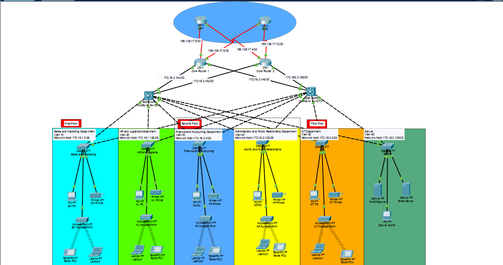
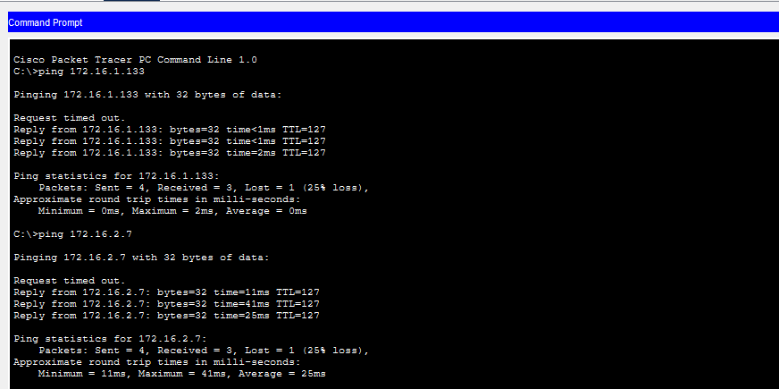
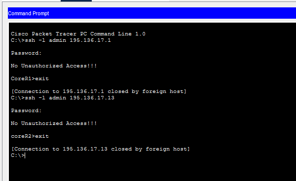

# Redundant Enterprise Network with Two ISPs (Cisco Packet Tracer)

A hierarchical enterprise network built in Cisco Packet Tracer. It has redundancy at every layer: two ISPs, two core routers, and two multilayer switches. Each department has its own VLAN, its own subnet, and its own wireless network, and a dedicated DHCP server in the server room gives out IP addresses to everyone.

## Topology



## Network Layers

| Layer | Devices |
|-------|---------|
| Internet | ISP1 and ISP2 (2811 routers) |
| Core | Core Router 1 and Core Router 2 (2911 routers) |
| Distribution | Multilayer Switch 1 and Multilayer Switch 2 (3650-24PS) |
| Access | One 2960-24TT switch per department, with a PC, printer, and access point |

Every core router connects to both ISPs, and every multilayer switch connects to both core routers, so the network keeps working if one router, switch, or ISP link fails.

## Addressing Plan

The base network is 172.16.1.0, subnetted to give each department the right number of addresses.

| Floor | Department | VLAN | Network | Usable Hosts |
|-------|------------|------|---------|--------------|
| First | Sales and Marketing | 10 | 172.16.1.0/25 | 126 |
| First | HR and Logistics | 20 | 172.16.1.128/25 | 126 |
| Second | Finance and Accounting | 30 | 172.16.2.0/25 | 126 |
| Second | Administration and Public Relations | 40 | 172.16.2.128/25 | 126 |
| Third | ICT | 50 | 172.16.3.0/25 | 126 |
| Server Room | Servers | 60 | 172.16.3.128/28 | 14 |

### Link networks

| Link | Network |
|------|---------|
| ISP1 - Core Router 1 | 195.136.17.0/30 |
| ISP1 and ISP2 cross links to the core routers | 195.136.17.4/30 and 195.136.17.8/30 |
| ISP2 - Core Router 2 | 195.136.17.12/30 |
| Core routers - Multilayer switches | 172.16.3.144/30, 172.16.3.148/30, 172.16.3.152/30, 172.16.3.156/30 |

The 195.136.17.x networks are the public addresses connecting the company to the two Internet providers.

## Features

- **Hierarchical design with redundancy:** two ISPs, two core routers, and two multilayer switches.
- **VLANs and subnets:** each department is in its own VLAN and its own subnet.
- **Wireless:** every department has an access point for laptops and tablets.
- **Inter-VLAN routing:** the multilayer switches route between the VLANs and carry out both routing and switching, so they have IP addresses.
- **OSPF:** used on the routers and the multilayer switches to share routes.
- **DHCP:** a dedicated DHCP server in the server room gives dynamic addresses to all departments.
- **Static addressing:** the servers in the server room use fixed IP addresses.
- **Basic device security:** hostnames, console and enable passwords, login banners, and IP domain lookup disabled.
- **SSH:** secure remote login on all routers and multilayer switches.
- **Port security:** Finance and Accounting switch ports allow only one device each, using sticky MAC addresses with violation mode shutdown.
- **PAT and ACL:** the core routers translate internal addresses to their outbound interface address so users can reach the Internet.

## Testing

- PCs in different departments can ping each other.
- SSH login works to the core routers, which show the warning banner.
- Devices reach the outside network through the ISPs.




## Repository Contents

```
.
├── README.md
├── project6.pkt
└── images/
    ├── topology.png
    ├── ping-test.png
    └── ssh-test.png
```

## How to Open

Open `project6.pkt` with Cisco Packet Tracer.
